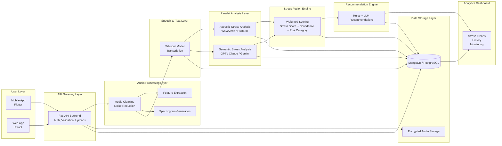
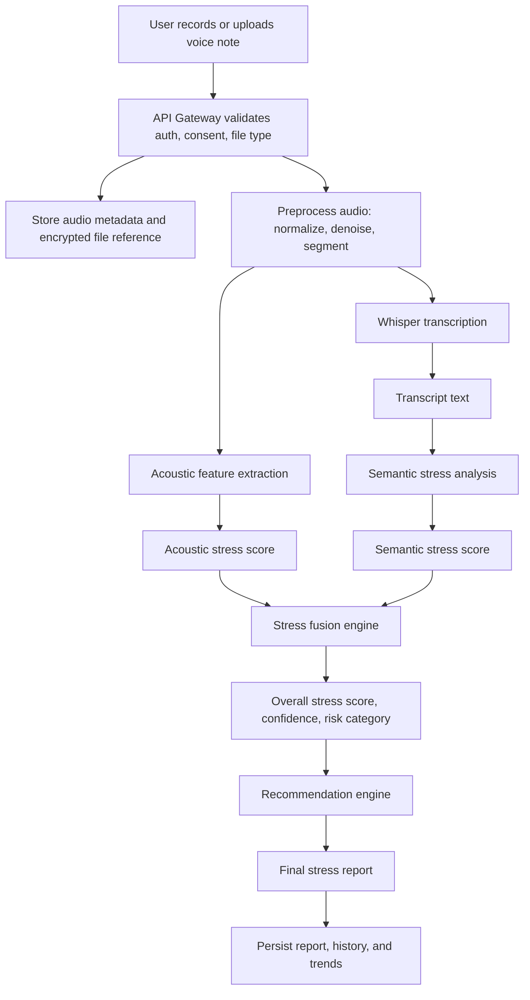
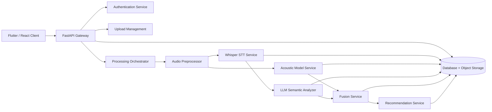
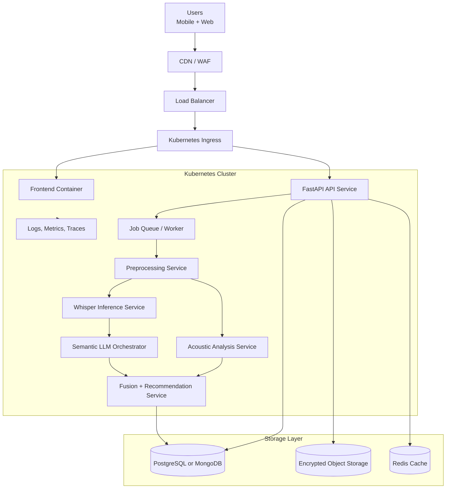
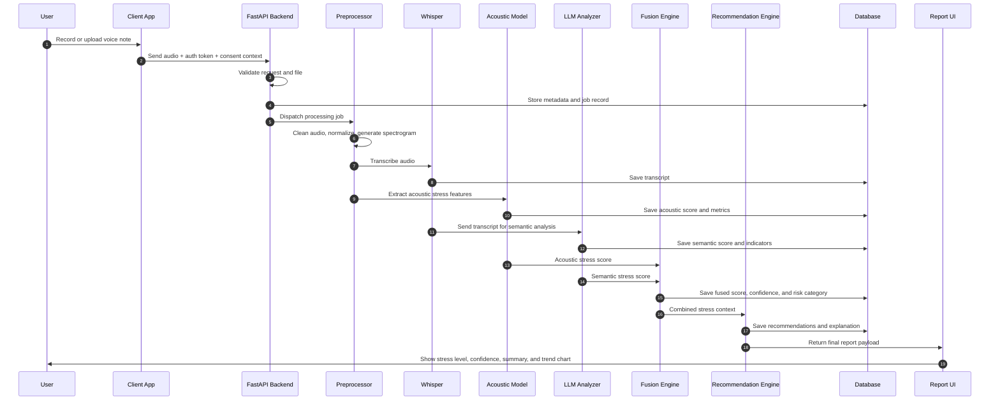

# AI-Powered Voice Stress Analysis Platform Architecture

This document defines the target architecture for the voice stress analysis platform and maps it to the current ExamStress-App codebase.

## 1. Target System Overview

The platform receives a user voice note, transcribes the audio, analyzes acoustic and semantic stress signals in parallel, fuses the results into a single stress-risk assessment, and returns personalized recommendations and trend insights.

## 2. High-Level Architecture Diagram

## 3. Data Flow Diagram

## 4. Component Interaction Diagram

## 5. Deployment Architecture

## 6. Sequence Flow: Voice Upload to Stress Report

## 7. Non-Functional Requirements

- Secure cloud deployment with TLS everywhere and encrypted storage at rest.
- Scalable microservice architecture so transcription, acoustic analysis, and LLM analysis can scale independently.
- Real-time or near-real-time processing using an async worker queue.
- End-to-end encryption for transport and stored audio.
- GDPR-compliant retention, deletion, auditability, and consent handling.
- API-driven architecture for mobile, web, and downstream analytics integrations.

## 8. Recommended Technology Stack

- Frontend: Flutter, React
- API Backend: FastAPI
- Transcription: Whisper
- Acoustic Analysis: Wav2Vec2 or HuBERT
- Semantic Analysis: GPT, Claude, or Gemini
- Database: PostgreSQL for relational reporting or MongoDB for document-oriented reports
- Infrastructure: Docker, Kubernetes, AWS / Azure / GCP

## 9. How This Maps to the Current Repo

Current implementation notes in this repository:

- [src/pages/VoiceSensePage.tsx](../src/pages/VoiceSensePage.tsx) currently performs browser-side audio analysis and uses the selected prompt as context. It does not yet call the backend transcription or scoring pipeline.
- [backend/routes/voice.py](../backend/routes/voice.py) already accepts voice uploads and stores derived acoustic features, but it does not yet run transcription or semantic analysis.
- [backend/services/audio_service.py](../backend/services/audio_service.py) contains placeholder acoustic feature extraction and score calculation logic suitable for a demo MVP.

## 10. Implementation Gaps To Close

1. Add a transcription service that receives uploaded audio and returns a transcript.
2. Persist transcript text alongside the audio metadata and analysis record.
3. Add a semantic analysis service that scores transcript content for stress indicators.
4. Add a fusion service to combine acoustic and semantic scores into one report.
5. Replace the current browser-only analysis path in the voice page with API calls to the backend workflow.
6. Add background jobs for long-running processing so upload requests stay responsive.
7. Add trend/report APIs for dashboard views and historical comparisons.

## 11. Suggested Delivery Phases

- Phase 1: Backend transcription and transcript persistence.
- Phase 2: Semantic analysis and fusion scoring.
- Phase 3: Recommendation generation and report APIs.
- Phase 4: Frontend integration for upload, live progress, and report display.
- Phase 5: Hardening for encryption, retention, audit logs, and scaling.
